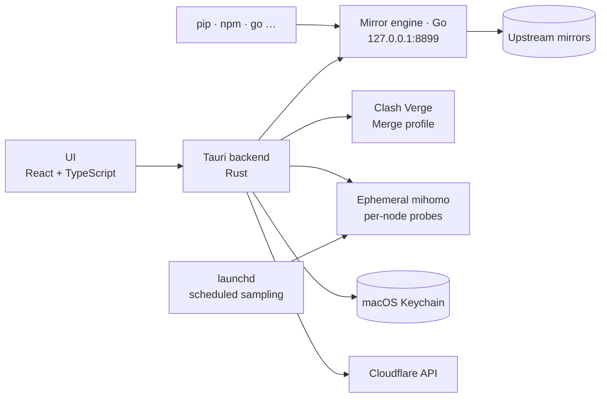

<div align="center">


# ProxyHub

A macOS app for managing package mirrors, traffic routing, proxy nodes and developer credentials in one window

[](#install)
[](https://tauri.app)
[](app/src-tauri)
[](engine)
[](https://github.com/MetaCubeX/mihomo)
[](https://github.com/Ysoseri1224/proxyhub/releases)
[](https://github.com/Ysoseri1224/proxyhub/actions/workflows/ci.yml)

[中文](README.md) · **English**

</div>

ProxyHub is a personal project for developers who move between network environments: package mirrors for dev tools, per-app and per-domain routing rules, quality checks on proxy nodes, and tokens and accounts scattered across files all live in one interface. Suggestions, issues and forks are welcome.

## Features

| Module | What it does |
|:--|:--|
| 📦 **Mirrors** | A local mirror engine for eight ecosystems: pip, npm, cargo, go, brew, docker, conda and CRAN. Each keeps a pool of upstreams ranked by health checks with automatic failover, and package files are cached on disk. Point every tool at the engine or back to the official source in one click, and add or remove mirrors and ecosystems from the UI. |
| 🧭 **Routing** | Assign destinations by app (process), domain, service set, IP range, region or port, using the policy groups from your subscription. Import rules from Clash and pull domains from browser bookmarks. Rules are written to the Clash Verge Merge profile with a backup before and a read-back check after, and can be rolled back in one click. A diagnoser shows which rule a given domain hits. |
| 🛰️ **Node check** | Measures each node's entry and exit IP, ASN, region, latency and loss, then compares them with what the node name advertises (exit region, direct/relay/dedicated line, residential/native IP, cloud vendor) and reports *consistent*, *mismatch* or *not independently verified*. Also rates exit IP purity and regional availability of ChatGPT, Claude and Gemini, traces the route to the entry, and samples during evening peak hours on a schedule. |
| 🔐 **Credentials** | Credentials are stored in the macOS Keychain and can be imported, viewed, injected and edited; tokens are looked up online for owner, scopes and expiry. Switch between GitHub accounts silently, launch Chrome profiles in one click, and see every dev tool's login state on one page. |
| ☁️ **Cloudflare** | Zone list, console shortcuts, and management of Email Routing rules and destination addresses. |

## Quick start

### Install

Download the dmg from [Releases](https://github.com/Ysoseri1224/proxyhub/releases) and drag it into Applications. The app is not notarized by Apple, so run this once before the first launch:

```bash
xattr -dr com.apple.quarantine /Applications/ProxyHub.app
```

Requires an Apple Silicon Mac. Routing and node checks need [Clash Verge Rev](https://github.com/clash-verge-rev/clash-verge-rev) with a subscription imported.

### Build from source

Requires Go 1.25, Rust stable and Node 22.

```bash
git clone https://github.com/Ysoseri1224/proxyhub.git && cd proxyhub
go -C engine build -o ../app/src-tauri/resources/proxyhub-engine .
cd app && npm ci && npm run tauri build
```

Bundles are written to `app/src-tauri/target/release/bundle/`. Use `npm run tauri dev` while developing.

## Architecture



## Design principles

- Credentials live only in the macOS Keychain; config files hold references.
- Clash Verge provides the full proxy dashboard; ProxyHub orchestrates rules and opens Clash Verge when needed.
- Every action reports its result and any error in the UI.
- Node checks run in a separate ephemeral core, leaving Clash Verge's live connections untouched.
- Hop counts, ASNs and latency are observations. Claims such as line grade, which need carrier records to confirm, are marked *not independently verified*.

## Command line

```bash
APP=/Applications/ProxyHub.app/Contents/MacOS/app
$APP --verify-report [profile uid]   # check a subscription and print a JSON report
$APP --verify-sample                 # sample all subscriptions once (called by launchd)
```

The mirror engine can also be used on its own. Each ecosystem is served under its own path prefix (`/pypi/` for pip):

```bash
pip config set global.index-url http://127.0.0.1:8899/pypi/
npm config set registry http://127.0.0.1:8899/npm/
go env -w GOPROXY=http://127.0.0.1:8899/go/
```

Control endpoints: `/_ph/status` for upstream health and cache usage, `/_ph/diagnose` for recent routing events, `/_ph/cache/clear` to empty the cache.

## Notes

- Per-app routing relies on process information and requires TUN mode in Clash Verge.
- IP ownership and purity come from public sources such as ip-api and ipinfo; verdicts are heuristic.
- Reading Safari bookmarks requires granting ProxyHub Full Disk Access under Privacy & Security.
- Clash Verge may rewrite the Merge profile; the status card on the Routing page flags this, and *Re-apply* restores the rules.
- Config and data are kept in `~/.config/proxyhub/`, the mirror cache in `~/.cache/proxyhub/`.

## Docs

- [SPEC.md](SPEC.md) · functional spec
- [DESIGN.md](DESIGN.md) · design notes
