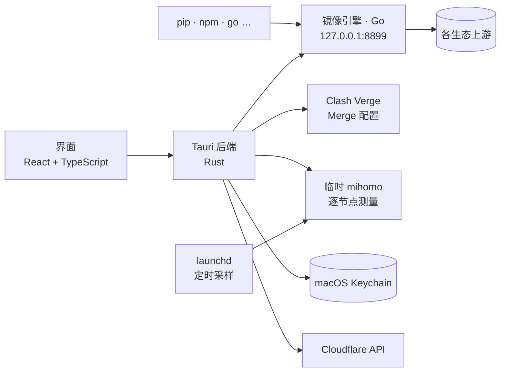

<div align="center">


# ProxyHub

在一个窗口里管理镜像源、网络分流、代理节点和开发凭据的 macOS 应用

[](#安装)
[](https://tauri.app)
[](app/src-tauri)
[](engine)
[](https://github.com/MetaCubeX/mihomo)
[](https://github.com/Ysoseri1224/proxyhub/releases)
[](https://github.com/Ysoseri1224/proxyhub/actions/workflows/ci.yml)

**中文** · [English](README.en.md)

</div>

ProxyHub 是一个个人项目，为经常在不同网络环境之间切换的开发者而写：开发工具的镜像源、按应用和域名的分流规则、机场节点的质量核验、散落各处的 token 与账号，集中在同一个界面里管理。欢迎提建议、开 issue，或拿去二次开发。

## 功能

| 模块 | 能做什么 |
|:--|:--|
| 📦 **镜像源** | 本地镜像引擎覆盖 pip、npm、cargo、go、brew、docker、conda、CRAN 八个生态。每个生态维护多个上游，按健康检查择优并自动故障转移，包文件落盘缓存。一键把各工具指向引擎或还原官方源，镜像和生态都能在界面里增删。 |
| 🧭 **网络分流** | 按应用（进程）、域名、服务集、IP 段、地区、端口编排去向，去向取自订阅里的策略组。规则可从 Clash 导入，域名可从浏览器书签批量提取。规则写入 Clash Verge 的 Merge 配置，写入前自动备份、写入后读回校验，支持一键回滚。诊断器输入域名即可看到命中的规则。 |
| 🛰️ **节点核验** | 逐节点测量入口与出口的 IP、ASN、地区、延迟和丢包，对照节点名里的宣传（落地地区、直连/中转/专线、家宽/原生、机房厂商），给出「一致」「不一致」或「未独立核实」。同时评估出口纯净度，以及 ChatGPT、Claude、Gemini 在该出口的地区可用性。支持到入口的路由追踪和晚高峰定时采样。 |
| 🔐 **凭据账号** | 凭据保存在 macOS Keychain，可导入、查看、注入和编辑，并在线查询 token 的归属账号、权限和有效期。GitHub 多账号静默切换，Chrome 多身份一键启动，各开发工具的登录状态汇总在一页。 |
| ☁️ **Cloudflare** | 域名列表、控制台快捷入口，以及 Email Routing 转发规则和目标地址的管理。 |

## 快速开始

### 安装

从 [Releases](https://github.com/Ysoseri1224/proxyhub/releases) 下载 dmg，拖入「应用程序」。应用未经 Apple 公证，首次打开前在终端执行：

```bash
xattr -dr com.apple.quarantine /Applications/ProxyHub.app
```

运行环境为 Apple Silicon Mac。网络分流和节点核验需要安装 [Clash Verge Rev](https://github.com/clash-verge-rev/clash-verge-rev) 并导入订阅。

### 从源码构建

需要 Go 1.25、Rust stable 和 Node 22。

```bash
git clone https://github.com/Ysoseri1224/proxyhub.git && cd proxyhub
go -C engine build -o ../app/src-tauri/resources/proxyhub-engine .
cd app && npm ci && npm run tauri build
```

安装包生成在 `app/src-tauri/target/release/bundle/`。开发调试用 `npm run tauri dev`。

## 架构



## 设计约定

- 凭据只保存在 macOS Keychain，配置文件里记录的是引用。
- 完整的代理面板由 Clash Verge 提供，ProxyHub 负责规则编排，需要时直接唤起 Clash Verge。
- 每个操作的结果和错误都如实显示在界面上。
- 节点核验在独立的临时内核里进行，测量期间 Clash Verge 的当前连接保持原样。
- 跳数、ASN、延迟属于观测线索。线路等级这类需要运营商资料才能确认的宣传，统一标注为「未独立核实」。

## 命令行

```bash
APP=/Applications/ProxyHub.app/Contents/MacOS/app
$APP --verify-report [订阅 uid]   # 核验订阅，输出 JSON 报告
$APP --verify-sample              # 对所有订阅采样一次（launchd 定时调用）
```

镜像引擎也可以单独接入，各生态的路径前缀与名称相同（`/pypi/` 对应 pip）：

```bash
pip config set global.index-url http://127.0.0.1:8899/pypi/
npm config set registry http://127.0.0.1:8899/npm/
go env -w GOPROXY=http://127.0.0.1:8899/go/
```

控制接口：`/_ph/status` 上游健康与缓存占用，`/_ph/diagnose` 最近的路由记录，`/_ph/cache/clear` 清空缓存。

## 使用须知

- 按应用分流依赖进程信息，需要在 Clash Verge 中开启 TUN 模式。
- IP 归属与纯净度来自 ip-api、ipinfo 等公开数据源，结论属于启发式判断。
- 读取 Safari 书签需要在「隐私与安全性 › 完全磁盘访问权限」中授权 ProxyHub。
- Clash Verge 有时会重写 Merge 配置，「网络分流」页的生效状态卡会提示，点「重新下发」即可恢复。
- 配置与数据位于 `~/.config/proxyhub/`，镜像缓存位于 `~/.cache/proxyhub/`。

## 文档

- [SPEC.md](SPEC.md) · 功能规格
- [DESIGN.md](DESIGN.md) · 设计说明
